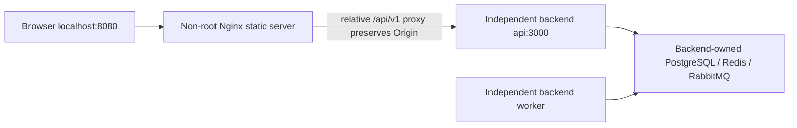

# Frontend architecture

React routes render shared navigation, labeled controls, event art, status labels, error states and confirmation dialogs. TanStack Query owns server data; session context owns only the current user and restoration status. The typed client uses generated OpenAPI types, runtime schema validation, credentialed relative fetches, memory-only access tokens and single-flight refresh. Commands keep actor-scoped ephemeral identities and unchanged payloads until completion or deliberate abandonment.

## Screen map and journeys

Visitor: /events → /events/:id → login/register when reserving → return to selection without auto-reserving.

Customer: /bookings/:id → /demo/checkout/:sessionId (local) or allowlisted Stripe-hosted checkout → /checkout/return → verified booking → /tickets/:id. Refund and cancellation require explicit confirmation; status is always reread from the API.

Organizer: /organizer → venue/event draft editor → category editor → publish → /organizer/events/:id → sales/check-in/cancel. Published commercial fields are read-only; title and description remain editable.

## Deployment

The web image builds without backend source or availability. Compose joins the backend-created configurable external network. E2E uses a separate frontend-owned project network and actual backend images/services, never development volumes.

## Recovery and privacy

Session restoration completes before protected content renders. Refresh rejection clears state. Web Locks serialize refresh across supporting tabs; session/logout broadcasts clear other tabs without persisting tokens. Unsupported browsers use a documented single-tab session. GET queries may retry transient failures; financial commands never automatically retry. Ambiguous commands show an explicit same-command retry. Pending/refund/artifact states remain separate. Unresolved checkout returns stop automatic polling after 60 seconds and provide manual refresh.

SVG ticket representations are rendered through image data URLs, never injected as markup. Credentials appear only on owner screens and in check-in JSON bodies. Event text is plain React text. Checkout URLs must use the same origin and exact demo path, or HTTPS checkout.stripe.com for Stripe test mode.
